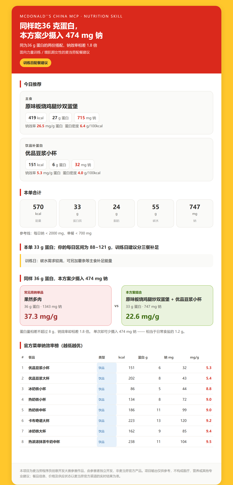

# 麦练营养官 · mcd-lift-nutrition-coach

> **同样吃一份蛋白，钠可以差 6.5 倍。**

面向**力量训练 / 增肌期女性**的麦当劳配餐 Skill。依据麦当劳官方 MCP 营养数据，把 160 条原始营养表重组成一个直接可用的指标：**钠效率 = 钠(mg) ÷ 蛋白质(g)**。

产出**可截图分享的单文件 HTML 配餐卡**与**复制即发的纯文本速查表**。

| 纯 Python 标准库 | 官方 MCP 实时数据 | 零第三方依赖 | 零外链 HTML |
|:--:|:--:|:--:|:--:|
| 3.9+ 即可运行 | `mcp.mcd.cn` 实测 | 无 `pip install` | 可离线打开 |



---

## 30 秒看懂：它和别的营养 Skill 差在哪

麦当劳 MCP 的营养数据人人可查，但排行榜上的营养类项目几乎都在回答同一个问题：

| 做法 | 代表项目 | 核心问题 | 停在哪 |
|---|---|---|---|
| 订单热量统计 | `mcd-order-calories` | 这单多少千卡 | 算完即结束 |
| 控卡省钱点餐 | `mcd-calorie-budget-skill` | 怎么点更省钱 | 点完即结束 |
| 制造热量缺口 | `mcd-100kcal` | 每天怎么少吃 100 大卡 | 数字即结束 |
| 三大营养素配比 | `mcd-macro-strategist` | 蛋白碳脂怎么配 | 配比即结束 |
| **本项目** | 麦练营养官 | **同样吃这份蛋白，钠能差多少** | 一直管到**可截图分享的配餐卡** |

**差异不在算不算热量，而在算的是不是"对的代价"。**

| 维度 | 热量 / 控卡类 | 本项目 |
|---|---|---|
| 核心指标 | 千卡 | **钠效率（mg/g 蛋白）** |
| 面向人群 | 泛减脂用户 | **力量训练 / 增肌期女性** |
| 真实痛点 | 热量盈余 | **训练后胀气、生理期水肿** |
| 产出形态 | 文字建议 / 数字 | **HTML 配餐卡 + 文本速查表** |
| 数据用法 | 逐条罗列 | **重组成一个决策指标** |

「训练后想吃得干净，代价是什么」—— 蛋白吃够要付出多少钠，这个问题在营养类项目里还没有人系统回答过。

---

## 一、数据里挖出的真东西

对官方 MCP `list-nutrition-foods` 返回的 **160 条**营养表实跑分析后，发现蛋白含量接近的单品间，钠效率差异巨大：

| 餐品 | 蛋白质 | 钠 | 钠效率 |
|---|---:|---:|---:|
| 冰牛奶大杯 | 15 g | **154 mg** | **10.3** |
| 儿童鱼排堡 | 15 g | 442 mg | 29.5 |
| 猪柳麦满分 | 16 g | 781 mg | 48.8 |
| 火腿扒早安营养卷 | 16 g | 1065 mg | 66.6 |

> 同为约 15~16 g 蛋白质，**钠效率相差 6.5 倍**。
> 其中「冰牛奶大杯」以极低的钠提供可观蛋白质，是整张表里的低钠蛋白锚点。

引擎在真实数据上跑出的方案：

| 方案 | 蛋白质 | 钠 | 钠效率 |
|---|---:|---:|---:|
| **本方案**（原味板烧鸡腿炒双蛋堡 + 优品豆浆小杯） | **33 g** | **747 mg** | **22.6** |
| 对照：果然多肉（蛋白量接近） | 36 g | 1343 mg | 37.3 |

> **单次少摄入约 474 mg 钠** —— 约合 **1.2 g 食盐**。

---

## 二、真实运行输出

```console
$ python scripts/main.py --weight 55 --training-day

麦练营养官 · 配餐速查表
==================================

【今日推荐】
  主食：原味板烧鸡腿炒双蛋堡
        419 kcal｜蛋白 27g｜钠 715mg｜钠效率 26.5 mg/g
  饮品：优品豆浆小杯
        151 kcal｜蛋白 6g｜钠 32mg｜钠效率 5.3 mg/g

【本单合计】
  570 kcal｜蛋白 33g｜脂肪 24g｜碳水 55g｜钠 747mg
  参考线：每日钠 < 2000 mg，单餐 < 700 mg

【本单 33 g 蛋白；你的每日区间为 88~121 g，训练日建议分三餐补足】
【训练日：碳水需求较高，可另加薯条等主食补足能量】

【同样 36 g 蛋白，本方案少摄入 474 mg 钠】
  常见高钠：果然多肉｜36g 蛋白｜1343mg 钠｜37.3 mg/g
  本方案组合：原味板烧鸡腿炒双蛋堡 + 优品豆浆小杯｜33g 蛋白｜747mg 钠｜22.6 mg/g
  钠效率相差 1.8 倍，单次少摄入约 1.2 g 食盐

【钠效率榜 · 越低越优】
   1. [饮品] 优品豆浆小杯
      151kcal｜蛋白6g｜钠32mg｜钠效率 5.3 mg/g
   2. [饮品] 优品豆浆大杯
      202kcal｜蛋白8g｜钠43mg｜钠效率 5.4 mg/g
   3. [饮品] 冰奶铁小杯
      86kcal｜蛋白5g｜钠44mg｜钠效率 8.8 mg/g
   ...
```

---

## 三、快速开始

### 1. 获取 MCP Token

访问 <https://open.mcd.cn/mcp>，手机号登录 → 控制台 → 激活 → 复制 Token（免费）。

> 每个 Token 每分钟最多 600 次请求。**Token 请勿写入代码或提交到仓库。**

### 2. 设置环境变量

```bash
export MCD_MCP_TOKEN=<你的 MCP Token>        # Linux / macOS
$env:MCD_MCP_TOKEN="<你的 MCP Token>"        # Windows PowerShell
```

### 3. 运行

```bash
# 实时调用 MCP
python scripts/main.py --weight 55 --training-day --html out/card.html

# 离线演示（内置快照，不消耗配额）
python scripts/main.py --demo --weight 55 --training-day
```

### 命令行参数

| 参数 | 说明 |
|---|---|
| `--weight KG` | 体重，**可选**。提供后按 1.6~2.2 g/kg 给出每日蛋白区间 |
| `--training-day` | 训练日（默认） |
| `--rest-day` | 休息日，提示减少主食 |
| `--html PATH` | 生成单文件 HTML 配餐卡 |
| `--top N` | 钠效率榜条目数，默认 8 |
| `--demo` | 离线模式，使用内置营养快照 |

### 4. 在 MCP 客户端中使用

复制 `mcp-config.example.json` 中的配置到你的 MCP 客户端即可（文件内仅含 `${MCD_MCP_TOKEN}` 环境变量占位符）。

### 示例产出

- `examples/sample-card-live.html` —— 配餐卡样例（单文件，可离线打开）
- `examples/sample-quick-reference.txt` —— 速查表样例

---

## 四、产出物

### HTML 配餐卡

单文件、零外链、零 JavaScript、零 CDN 依赖 —— 断网也能打开，可直接截图分享。

包含：今日推荐 / 本单合计 / 蛋白目标对照 / 钠对比论断 / 钠效率榜。

### 纯文本速查表

复制即可粘贴到微信、Slack、Notion 等任意工具，无需任何格式支持。

---

## 五、目标用户

- **主要**：进行力量训练、处于增肌期、在意钠摄入的女性
- **次要**：需要高蛋白低钠配餐建议的其他健身人群
- **不适合**：减脂热量缺口需求者、有医疗营养需求者

> 本项目不提供医疗、营养或其他专业建议。

---

## 六、项目结构

```
.
├── SKILL.md                 Skill 主流程与触发场景
├── CONTEXT.md               领域术语表（不含实现细节）
├── README.md
├── MCP_INTEGRATION.md       MCP Server / Tool / 调用流程 / 业务价值
├── CONTEST_DECLARATION.md   参赛声明（官方原版，内容未改动）
├── mcp-config.example.json  脱敏 MCP 配置（仅环境变量占位符）
├── workbuddy.md             WorkBuddy 开发对话上下文
│
├── scripts/
│   ├── toon.py              TOON 格式解析器（官方 data 字段非 JSON）
│   ├── mcd_client.py        MCP 客户端（纯标准库）
│   ├── nutrition.py         营养引擎：指标 / 排序 / 配餐生成
│   ├── build_card.py        渲染层：HTML 配餐卡 + 文本速查表
│   ├── main.py              命令行入口
│   └── nutrition_snapshot.json  内置营养快照（离线演示用）
│
├── docs/
│   ├── adr/                 架构决策记录
│   └── preview-card.png     配餐卡预览图
│
└── examples/                样例产出物
```

---

## 七、技术要点

### 官方返回的不是 JSON

`list-nutrition-foods` 的 `data` 字段是 **TOON 紧凑行式格式**：

```
[160]{productName,nutritionDescription,energyKj,energyKcal,protein,fat,carbohydrate,sodium,calcium}:
  猪柳麦满分,null,1288,308,16,16,24,781,213
```

外层还包了一段 MCP 自动生成的说明文本，需**两层解包**。本项目实现了完整的解析器（`scripts/toon.py`），从**末尾固定 6 个数值槽位**向左切分，避免品名含逗号导致错位。

### 为什么只用一个 MCP Tool

核心推荐**仅依赖 `list-nutrition-foods` 一个工具**，用户无需提供地址即可获得完整建议。门店在售校验（`query-meals`）作为可选增强降级处理，避免地址依赖链阻断主流程。

### 钠效率需要热量约束兜底

单纯按钠效率排序会推荐出「培根双层安格斯厚牛堡」（987 kcal / 55 g 蛋白）—— 钠效率确实优秀，但单餐近 1000 kcal 并不合理。因此主食候选加了**蛋白 ≥14 g 且热量 ≤700 kcal** 的双重约束。

---

## 八、数据局限（请务必留意）

| 局限 | 说明 |
|---|---|
| 营养表是**固定快照** | 160 条记录，**不含门店实时在售状态** |
| **无过敏原信息** | 有过敏史者**必须另行确认**，不能依赖本数据 |
| **无配料表** | 无法判断具体成分 |
| **无份量维度** | 仅覆盖官方标明规格（大杯 / 中杯 / 4 块等） |
| 存在重复条目 | 部分品名在官方数据中重复，已去重 |

餐品信息、价格及供应状态**以麦当劳官方渠道的实时结果为准**。

---

## 九、合规声明

- 本项目为麦当劳程序员创意开发大赛参赛作品，由参赛者独立开发，**非麦当劳官方产品**
- 项目输出**仅供参考，不构成医疗、营养或其他专业建议**
- 项目内**不含任何真实 Token**，配置仅使用环境变量占位符
- 项目**不与任何其他餐饮品牌做对比**
- 项目**不以减肥、瘦身为核心叙事**，聚焦训练支持与增肌补给

详见 [`CONTEST_DECLARATION.md`](CONTEST_DECLARATION.md)（官方原版，内容未作任何改动）。

---

## 十、许可

MIT，见 [`LICENSE`](LICENSE)。

数据来源：麦当劳中国官方 MCP Server。餐品名称与营养数据版权归麦当劳中国所有。
